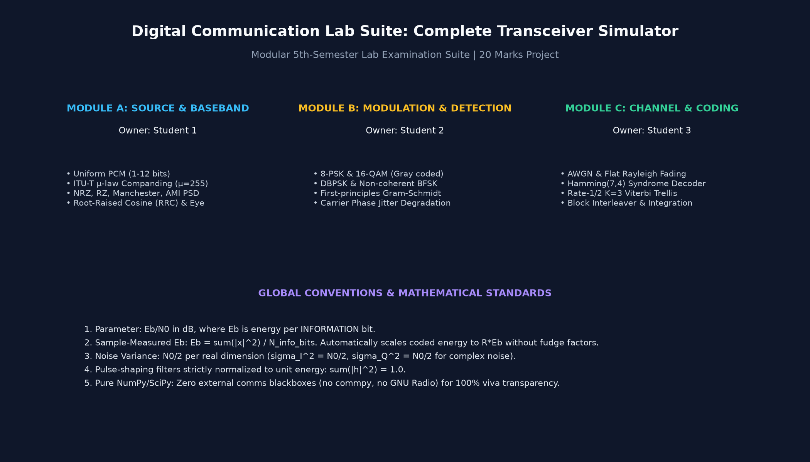
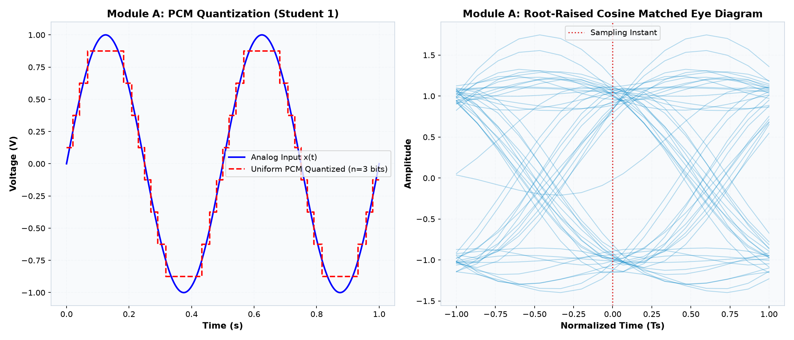
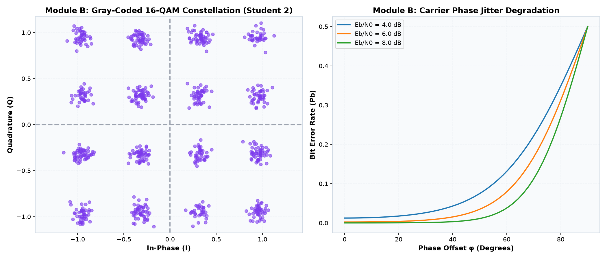
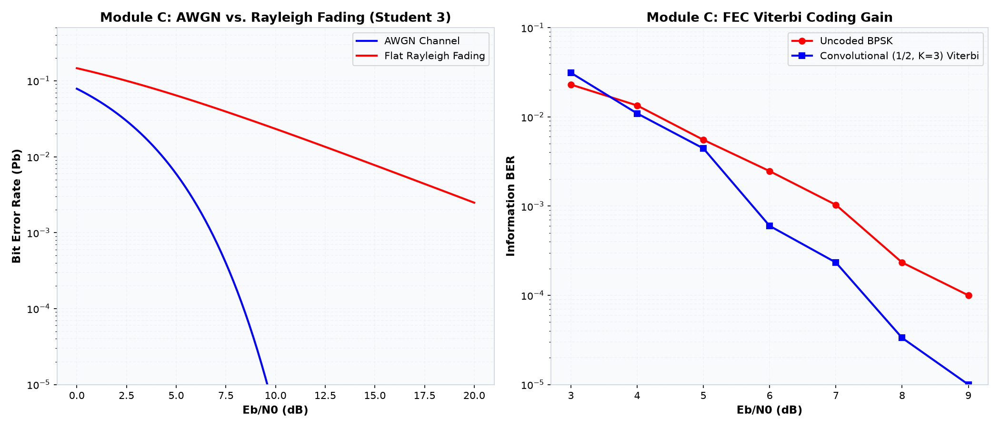
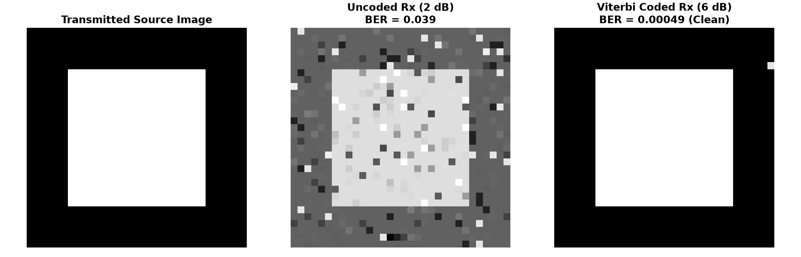

# Digital Communication Lab Suite: A Complete Transceiver Simulator

[](https://www.python.org/downloads/)
[]()
[-orange.svg)]()
[]()

A research-grade, modular, first-principles digital communication transceiver simulator developed in Python for a 5th-semester Digital Communication curriculum (20 marks). The project is specifically engineered for a team of 3 students to present in a viva examination, with distinct module ownership, full code modularity, transparent mathematical derivations, zero third-party communication blackboxes (no `commpy`, no `GNU Radio`), and complete GUI interactivity via Streamlit.

---

## 👥 Student Team Ownership & Partitioning

| Module | Lab Domain | Student Owner | Core Responsibilities & Files |
| :--- | :--- | :--- | :--- |
| **Module A** | Source Coding & Baseband Lab | **Student 1** | PCM Quantization, $\mu$-Law Companding, Line Coding (NRZ, RZ, Manchester, AMI), PSD Analysis, RRC Pulse Shaping, Eye Diagrams, ISI Analysis.<br>`dcsim/source/` |
| **Module B** | Modulation & Detection Lab | **Student 2** | Complex Baseband 8-PSK & 16-QAM (Gray), Non-coherent DBPSK & BFSK, First-Principles Gram-Schmidt Engine, Carrier Phase Jitter, Tradeoff Dashboard.<br>`dcsim/modulation/` |
| **Module C** | Channel Impairments, FEC & Transceiver Integration | **Student 3** | AWGN & Flat Rayleigh Fading with CSI, Repetition(3), Hamming(7,4) Syndrome Decoder, Rate-1/2 $K=3$ Viterbi Trellis Decoder, Block Interleaver, Transceiver Pipeline, Streamlit App.<br>`dcsim/channel/`, `dcsim/coding/`, `dcsim/transceiver.py`, `app.py` |

---

## 📐 Global Conventions & Standards

1. **User-Facing Parameter:** $E_b / N_0$ in decibels (dB), where $E_b$ is strictly the energy per **INFORMATION** bit (not per coded bit, nor per channel symbol).
2. **Sample-Measured $E_b$:**
   $$E_b = \frac{\sum_{k=1}^N |x[k]|^2}{N_{\text{info\_bits}}}$$
   Measuring $E_b$ directly from the synthesized discrete waveform $x$ guarantees that oversampling factors, pulse-shaping energy, carrier scaling, and channel coding rates ($R = k/n$) are accounted for automatically without manual fudge factors. Coded systems automatically give energy $R \cdot E_b$ per channel symbol.
3. **AWGN Noise Spectral Density ($N_0$):**
   $$N_0 = \frac{E_b}{10^{(E_b/N_0)_{\text{dB}} / 10}}$$
   - **Real passband channel:** Noise variance $\sigma^2 = N_0 / 2$ per real dimension.
   - **Complex baseband channel:** Complex noise $w = w_I + j w_Q$ with $w_I, w_Q \sim \mathcal{N}(0, N_0 / 2)$, giving total variance $\mathbb{E}[|w|^2] = N_0$.
4. **Gaussian Tail Q-Function:**
   $$Q(x) = \frac{1}{2} \operatorname{erfc}\left(\frac{x}{\sqrt{2}}\right)$$
5. **Unit Energy Pulse Shaping:** All transmit and receive filter impulse responses strictly satisfy $\sum |h[k]|^2 = 1.0$.
6. **Reproducibility:** Seeded random generators (`np.random.default_rng(seed)`), vectorized NumPy operations for snappy GUI interaction, with a Quick Mode ($1.5 \times 10^4$ bits) and Accurate Mode ($8.0 \times 10^4$ bits) toggle.

---

## 📋 Engineering Assumptions

1. **Carrier Synchronization in Core Link:** Coherent demodulators for BPSK, QPSK, coherent BFSK, and OOK assume nominal carrier frequency and phase alignment at the receiver, matching typical textbook transceiver models. Phase jitter is independently studied in Module B.
2. **Channel State Information (CSI):** The flat Rayleigh fading channel provides perfect instantaneous Channel State Information ($h$) at the receiver, modeling pilot-assisted maximum-ratio derotation: $\hat{x} = \frac{h^*}{|h|^2} y$.
3. **Hard-Decision Viterbi Decoding:** The rate-1/2 convolutional decoder utilizes hard-decision Hamming branch metrics, which allows students to trace individual branch distance calculations by hand during viva questioning.
4. **Image & Audio Sizing for Live Demo:** Uploaded or synthesized audio is sampled at 8 kHz mono; test images are formatted as 8-bit grayscale ($32 \times 32$ pixels) to guarantee instantaneous simulation execution during a live examiner demonstration.

---

## ⚡ Quick Start & Run Commands

### 1. Environment Setup
Requires Python 3.10 or higher.
```bash
# Clone or navigate to the repository
cd DC

# Install verified dependencies
pip install -r requirements.txt
```

### 2. Run All Automated Verification Tests
Executes 51 unit and integration tests across all modules:
```bash
py -m pytest tests/ -v
```

### 3. Generate All Lab Report Figures
Runs complete simulations and generates 11 publication-quality PNG figures into `outputs/figures/`:
```bash
py scripts/generate_figures.py
```

### 4. Launch the Interactive Streamlit Web GUI
```bash
py -m streamlit run app.py
```
Open your browser at `http://localhost:8501`.

---

## 🖼️ Application Screenshots & Visual Dashboards

### 1. Home Dashboard & Transceiver Block Architecture


### 2. Module A: PCM Staircase & Root-Raised Cosine Eye Diagram (Student 1)


### 3. Module B: 16-QAM Constellation & Phase Jitter Degradation (Student 2)


### 4. Module C: AWGN vs Rayleigh Fading & FEC Viterbi Coding Gain (Student 3)


### 5. End-to-End Transceiver: Source to Sink Payload Transmission


---

## 📁 Repository Directory Structure

```text
DC/
├── app.py                         # Streamlit interactive multi-tab application
├── requirements.txt               # Strict package dependencies (NumPy, SciPy, Matplotlib, Pillow, Streamlit, pytest)
├── README.md                      # Primary project overview, setup, conventions, assumptions
├── dcsim/                         # Transceiver Simulator Core Package
│   ├── __init__.py
│   ├── transceiver.py             # Full end-to-end transceiver pipeline
│   ├── core/                      # Shared Core Link (Phase 1)
│   │   ├── conventions.py         # Eb/N0, AWGN noise generator, Q-function
│   │   ├── passband_link.py       # Passband BPSK, QPSK, BFSK, OOK correlator transceivers
│   │   └── converters.py          # Lossless Text & Image <-> Binary converters
│   ├── source/                    # Module A: Source & Baseband Lab (Student 1)
│   │   ├── pcm.py                 # Uniform quantizer, mu-law companding, SQNR, aliasing
│   │   ├── line_coding.py         # NRZ-L, RZ, Manchester, AMI waveforms & Welch PSD
│   │   └── pulse_shaping.py       # Root-Raised Cosine (RRC), eye diagrams, ISI demo
│   ├── modulation/                # Module B: Modulation & Detection Lab (Student 2)
│   │   ├── advanced_mod.py        # 8-PSK, 16-QAM, DBPSK, Non-coherent BFSK
│   │   ├── signal_space.py        # First-principles Gram-Schmidt engine
│   │   ├── phase_offset.py        # Carrier phase error simulation & BPSK theoretical bound
│   │   └── comparison.py          # Spectral efficiency, threshold table, recommendation engine
│   ├── channel/                   # Module C: Channel Impairments (Student 3)
│   │   └── fading.py              # Flat Rayleigh fading with perfect CSI
│   ├── coding/                    # Module C: Error-Control Coding (Student 3)
│   │   ├── repetition.py          # Repetition(3) majority logic
│   │   ├── hamming.py             # Systematic Hamming(7,4) syndrome decoding
│   │   ├── convolutional.py       # Rate-1/2 K=3 (7,5) octal Viterbi trellis decoder
│   │   ├── interleaver.py         # Rectangular block matrix interleaver
│   │   └── system.py              # Coded link evaluation & coding gain measurement
│   ├── plots/                     # Presentation Plotting Theme & Utilities
│   │   ├── styling.py             # Clean dark & light Matplotlib themes
│   │   ├── ber_plots.py           # BER waterfall plotting with theoretical overlays
│   │   └── eye_diagram.py         # Eye diagrams & complex constellation plots
│   └── utils/
│       ├── audio_helpers.py       # Audio synthesis, SNR measurement, WAV I/O
│       └── image_helpers.py       # Image PSNR, MSE calculation
├── tests/                         # Pytest Verification Suite (51 Passing Tests)
│   ├── test_phase1_core.py        # Core passband links, converters, conventions
│   ├── test_module_a.py           # PCM SQNR (within 1 dB), companding, line codes, RRC
│   ├── test_module_b.py           # 8-PSK, 16-QAM, Gram-Schmidt orthonormality, phase offset
│   ├── test_module_c.py           # Rayleigh fading, Hamming, Viterbi coding gain, interleaver
│   └── test_full_transceiver.py   # Noiseless end-to-end roundtrips across all sources
├── scripts/
│   ├── generate_figures.py        # Generates 11 publication report figures to outputs/figures/
│   └── capture_ui_cards.py        # Generates UI visual dashboard cards to outputs/screenshots/
├── docs/
│   ├── THEORY.md                  # Comprehensive mathematical derivations in simple student language
│   ├── REPORT.md                  # Full 15-page draft project lab report
│   ├── VIVA_QA.md                 # 40 viva examination questions & answers grouped by module
│   ├── TEAM_GUIDE.md              # Student ownership mapping & 10-minute demo script
│   └── PRESENTATION_OUTLINE.md    # 10-slide oral presentation outline
└── outputs/
    ├── figures/                   # 11 generated simulation figures
    └── screenshots/               # UI dashboard screenshots
```

---

## 📚 Complete Viva Documentation
Detailed companion guides are provided in `docs/`:
- **[Theory Guide](docs/THEORY.md):** Plain-English and mathematical explanations of every transceiver block.
- **[Lab Report](docs/REPORT.md):** 15-page comprehensive project report suitable for course submission.
- **[Viva Q&A Guide](docs/VIVA_QA.md):** 40 common examiner questions with concise, correct answers.
- **[Team Demo Guide](docs/TEAM_GUIDE.md):** 10-minute viva oral script with precise timestamps and handoffs.
- **[Presentation Outline](docs/PRESENTATION_OUTLINE.md):** 10-slide oral presentation deck outline.
